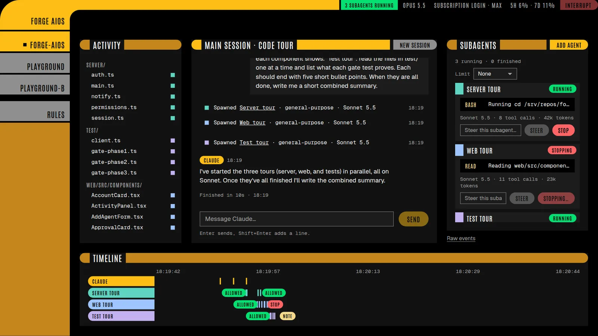

# Forge AIOS

A cockpit for Claude Code in your browser. One main session sits in the middle. Every subagent it launches appears beside it, and you can steer or stop each one. An activity view shows every file the agents touched, the git diff, and a timeline of who did what.


Forge AIOS runs the official Claude Code command-line tool, unmodified, and signs in with **your own** Claude account or Anthropic API key. Forge never sees your credentials: you sign in through Claude Code's own login.

> Forge AIOS is a free, open-source community project. It is not made, endorsed or supported by Anthropic.

## Status

| How to run it | State |
| --- | --- |
| On a Linux server or PC with Docker ("server mode") | Works today: this is how it was built and is used daily |
| Windows app with an installer | In progress; there's no download yet |

## What it does

- **Chat with one main Claude Code session** with live replies, and send messages mid-turn. Interrupt it at any time.
- **See every subagent** as a card: what it was asked to do, the tool call it's running now, and a feed of everything it did.
- **Steer a subagent:** your note reaches it before its next tool call. **Stop one:** it finishes the current step, then reports back. The main session is told what you said to its subagents.
- **Approve tool calls** from the browser, or from your phone through [ntfy](https://ntfy.sh). Choose how much asks:
  - **Ask:** every edit and shell command needs your approval, until you allow it for the session.
  - **Trusted project** (the default): edits inside the project, plus commands that look around, build, test and commit, run without asking. Deleting, pushing, network access, and anything outside the project still ask.
  - **Allow everything:** nothing asks.
- **Activity view:** files touched per agent, the git diff, and timeline lanes. Click anything to jump to that moment in the chat.
- **Projects:** every folder in your projects directory is a project with its own session. Sessions run side by side and resume where they left off.
- **Session rules:** the model for the main session and for new agents, limits on how many agents run at once (overall and per model), and approval settings, each with a default you set once.
- **Knowledge graphs:** link a wiki repo so Claude can read it while it works. Linked wikis are read-only, and Claude can't change them. You can also create a new wiki from a session.



## Server mode (Docker)

You need a Linux machine with Docker and git, and a Claude subscription (Pro, Max, Team or Enterprise) or an Anthropic API key.

1. Clone the repo where your projects will live alongside it:

   ```sh
   sudo mkdir -p /srv/repos && sudo chown "$USER" /srv/repos
   git clone https://github.com/matticusanvil/forge-aios /srv/repos/forge-aios
   cd /srv/repos/forge-aios
   ```

2. Create your settings file from the example and fill it in:

   ```sh
   mkdir -p ~/.config/forge-aios
   cp deploy/env.example ~/.config/forge-aios/env
   chmod 600 ~/.config/forge-aios/env
   ```

3. Build and start it:

   ```sh
   sh deploy/run.sh
   ```

4. Sign in to Claude Code inside the container, once:

   ```sh
   docker exec -it forge-aios claude
   ```

   Follow Claude Code's sign-in. You can use your Claude account, or paste an API key. Then type `/exit`.

5. Open `http://<your-server>:3200`. The first visit asks you to set a password. To prove you run the server, it asks for a one-time setup code from the container log:

   ```sh
   docker logs forge-aios 2>&1 | grep -i "setup code"
   ```

Projects are the folders in `/srv/repos` next to Forge's own; hidden folders are skipped. You can also create a project, or clone one from GitHub, on the Projects page.

**Updating:** `git pull && sh deploy/run.sh`. Each build is tagged, so `sh deploy/rollback.sh` goes back to the one before.

**Backups:** `deploy/forge-backup.sh` copies Forge's data (sessions, rules, the sign-in file) to a dated folder. `deploy/forge-backup.service` and `.timer` run it nightly.

**Android emulator (optional):** if the server has an Android SDK in `~/android-sdk` and `/dev/kvm`, Forge mounts them and gives Claude an `android-emulator start|stop` command for a headless emulator.

### Settings

All settings live in `~/.config/forge-aios/env` on the server; the template is `deploy/env.example`.

| Setting | What it does |
| --- | --- |
| `FORGE_PROJECT` | The project a new browser opens first, e.g. `/srv/repos/playground`; projects are the folders beside it |
| `FORGE_API_TOKEN` | A long random token for scripts and the live tests (`openssl rand -hex 32`) |
| `FORGE_PUBLIC_URL` | The address your phone uses to reach Forge, for the buttons in phone pushes |
| `NTFY_URL`, `NTFY_TOPIC`, `NTFY_TOKEN` | Phone approvals through ntfy; leave empty to turn them off |
| `FORGE_PARK_MINUTES` | Idle sessions stop after this long (default 30) and resume on the next message |
| `GIT_AUTHOR_EMAIL`, `GIT_COMMITTER_EMAIL` | The email on commits Claude makes |

## Security

Forge AIOS runs Claude Code, which can run commands and change files in your projects. Treat it like shell access to the machine it runs on:

- Run it on your own machine or home network, behind its password. Don't expose port 3200 to the internet; use a VPN such as Tailscale to reach it from elsewhere.
- Every tool call passes through Forge's approval check, so nothing outside your approval level runs without asking.
- Steering notes carry a per-session secret tag. Text planted in files or command output can't pose as you.

Found a vulnerability? See [SECURITY.md](SECURITY.md).

## Developing

Forge is TypeScript run directly by Node 22.18+ (no build step for the server), with a React and Vite front end.

```sh
npm install
npm run check   # typecheck the server and the web app
npm test        # fast tests, no Claude needed
npm run build   # build the web app
```

The **live gate tests** in `test/` drive a running Forge over the same WebSocket as the browser. They use real Claude turns on your account. They start new sessions in the `playground` and `playground-b` projects, so don't run them while you're working there. `playground` needs the files in `test/fixture-project`.

```sh
FORGE_URL=http://your-server:3200 FORGE_API_TOKEN=... npm run gates
```

Contributions are welcome: see [CONTRIBUTING.md](CONTRIBUTING.md).

## License

[Apache License 2.0](LICENSE). Copyright 2026 Anvil Digital.

Claude Code is Anthropic's software, used under Anthropic's terms, and isn't included in this repository. "Claude" and "Claude Code" are trademarks of Anthropic.
