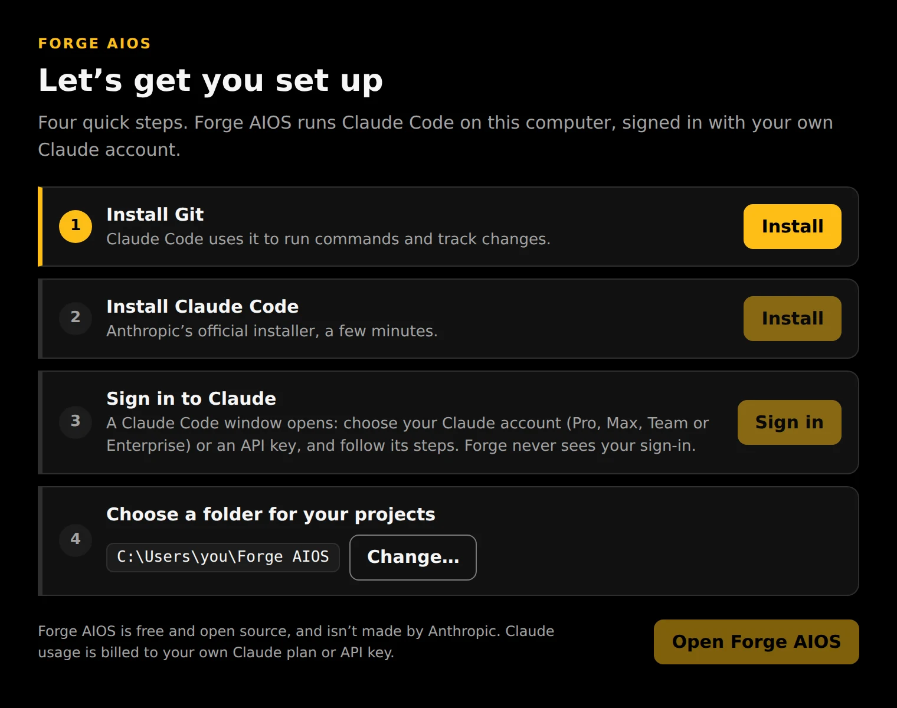
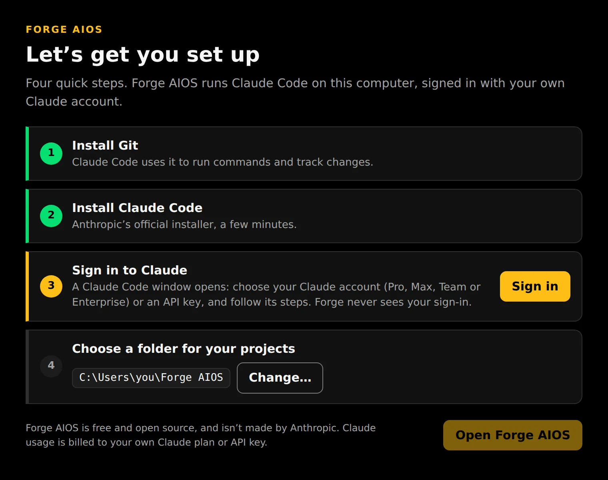
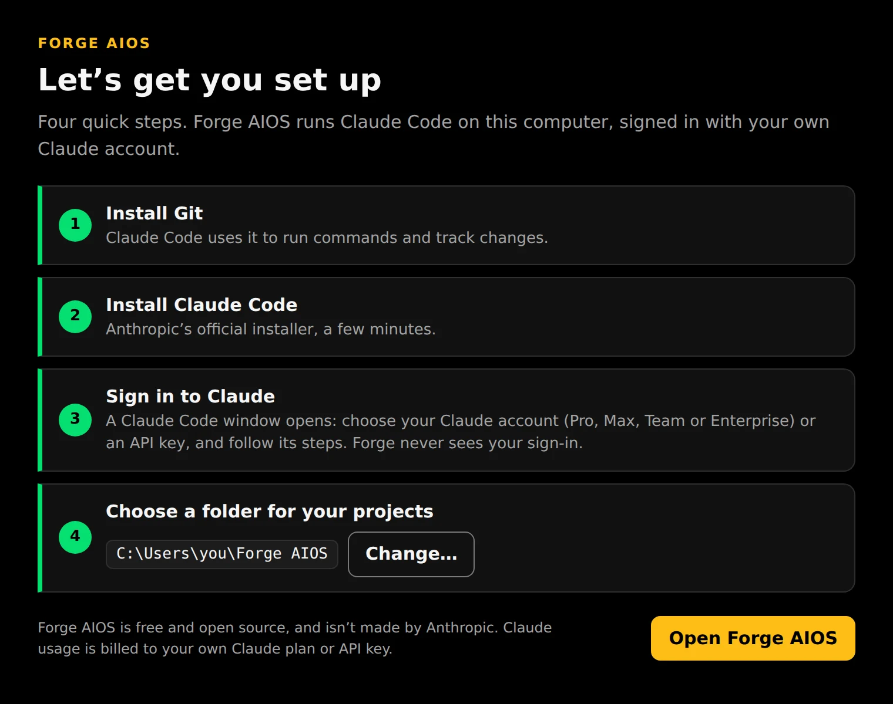

# Install Forge AIOS on Windows

This takes about ten minutes. You need Windows 10 or 11 and a Claude account: a Pro, Max, Team or Enterprise plan, or an Anthropic Console account with API billing. You don't need admin rights, and you won't need to type any commands.

## 1. Download

Go to the [latest release](https://github.com/matticusanvil/forge-aios/releases/latest). Under **Assets**, download **Forge-AIOS-Setup-x.y.z.exe**.

## 2. Install

Open the file you downloaded. Forge AIOS installs for your Windows account only, then starts.

> **If Windows says "Windows protected your PC":** Windows shows this for apps it hasn't seen many times before. Click **More info**, check that the publisher is **Anvil Digital**, then click **Run anyway**.

## 3. Set up (first time only)

Forge AIOS shows four steps. Each one turns green when it's done.

1. **Install Git.** Click **Install**. Windows may ask for permission; say yes. If it can't install Git by itself, its download page opens in your browser. Install it there, then click **Check again**.
2. **Install Claude Code.** Click **Install**. This runs Anthropic's official installer and takes a few minutes.
3. **Sign in to Claude.** Click **Sign in**. A Claude Code window opens; follow its steps:
    - Pick a colour theme (any is fine).
    - Choose the option for a Claude subscription to use your Pro, Max, Team or Enterprise plan. Your browser opens so you can sign in to Claude. To pay per use instead, choose the Anthropic Console option.
    - When Claude Code says you're signed in, close its window. The setup screen notices on its own.

    

    Forge AIOS never sees your password or key: you sign in through Anthropic, inside Claude Code itself.
4. **Choose a folder for your projects.** The suggested one is fine. Click **Change…** to pick another.

Click **Open Forge AIOS**.

## 4. Your first session

Forge opens with a **welcome** project. Type a request in the box at the bottom of the middle panel, for example *"Make a simple web page that shows today's date."*

- **The middle** is your conversation with Claude.
- **Right side:** when Claude hands parts of the work to helper agents ("subagents"), each gets a card here. **Steer** sends it a note; **Stop** has it finish its current step and report back.
- **Left side:** every file Claude read or changed, with the changes.
- **Approvals:** Claude asks before anything risky, such as deleting files, using the internet, or touching anything outside the project. Click **Allow** or **Deny**. **Allow for session** stops it asking again for that kind of action until you start a new session.

To work on your own code, open **Projects** (the gold corner at the top left). You can pick any folder on your computer with **Open a folder on this computer**, clone a GitHub repo, or create a new empty project.

## Good to know

- **Closing the window doesn't stop Forge.** Agents keep working in the background. Forge AIOS stays in the system tray (the icons by the clock). Right-click its icon to open it again, start it with Windows, or quit.
- **Updates install themselves.** When one is ready, Forge tells you, and it installs the next time you quit.
- **Usage counts against your Claude plan.** The top bar shows how much of your plan's five-hour and weekly limits you've used. Forge runs at most 3 agents at once by default; change that under **Rules**.
- **How much Claude asks first:** see **Rules → Approval level**. **Trusted project** (the default) lets Claude edit files and build and test inside the project without asking.

## Uninstall

Open **Settings → Apps → Installed apps**, find **Forge AIOS**, and click **Uninstall**. You'll be asked whether to also remove Forge's history and settings. Your project folders are never removed.

Claude Code and Git stay installed. Remove them separately in **Installed apps** if you no longer want them.

Something not working? See [Troubleshooting](troubleshooting.md).
